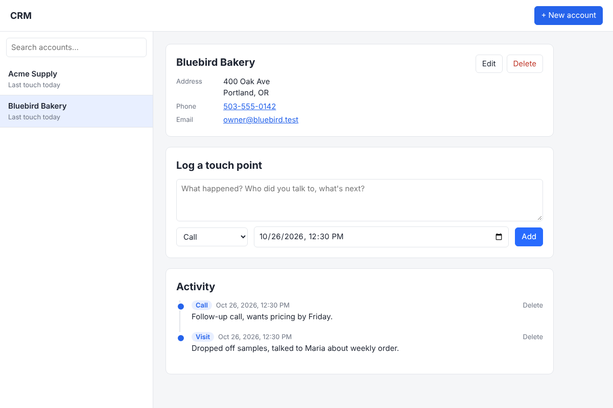

# CRM



A simple, single-user CRM for keeping track of business accounts. Each account has a business name, address, phone number and email, plus an activity feed where you log every sales touch point (call, email, meeting, visit or note) with a date and time.

## Run it

You need [Node.js](https://nodejs.org) 22.13 or newer.

```sh
npm install
npm start
```

Then open http://localhost:3000.

Everything is stored in a single SQLite file, `crm.db`, in the project folder. Back it up by copying that file. To use a different location or port:

```sh
DB_PATH=/path/to/crm.db PORT=8080 npm start
```

## What's inside

- `server.js`: Express server and JSON API, using Node's built-in SQLite
- `public/`: the web page (plain HTML, CSS and JavaScript, no build step)

## API

| Method | Path | What it does |
| --- | --- | --- |
| GET | `/api/accounts?q=` | List accounts (optional search) with last touch date |
| POST | `/api/accounts` | Create an account |
| GET | `/api/accounts/:id` | Get an account and its notes feed |
| PUT | `/api/accounts/:id` | Update an account |
| DELETE | `/api/accounts/:id` | Delete an account and its notes |
| POST | `/api/accounts/:id/notes` | Log a touch point (`body`, `kind`, `occurred_at`) |
| DELETE | `/api/notes/:id` | Delete a note |

There is no login, so run it on your own computer or behind something that adds a password before putting it on the internet.
